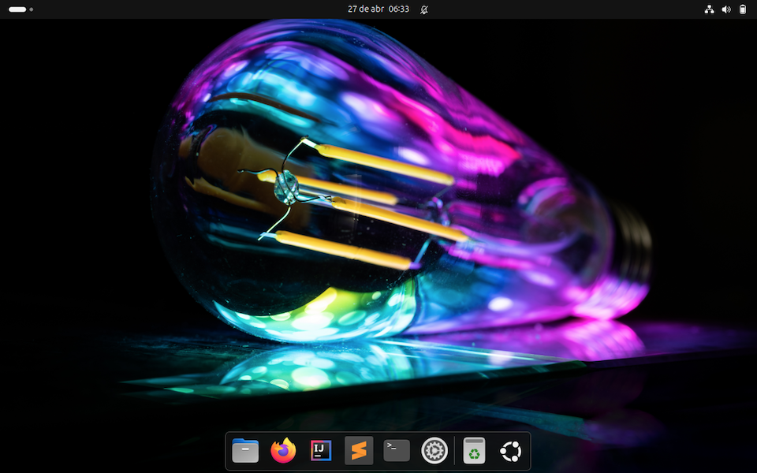
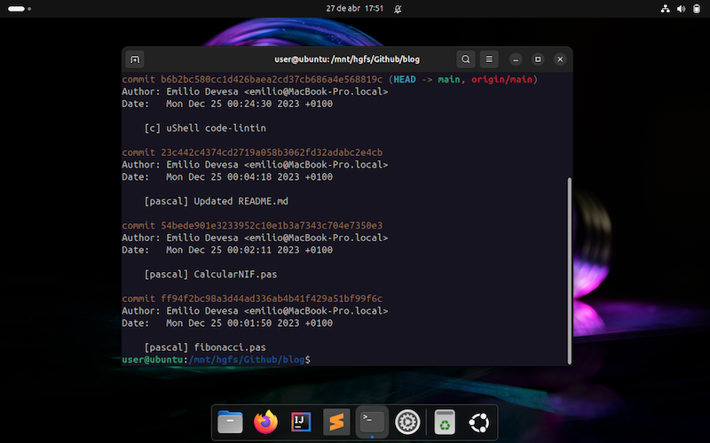
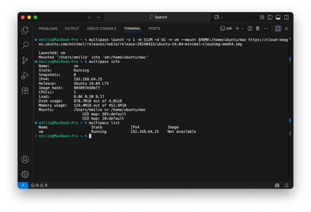
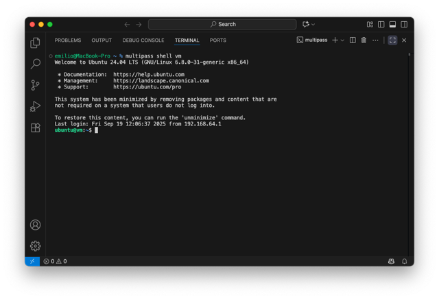

## Ubuntu on VMWare Fusion
First, I installed Ubuntu on a virtual machine created with VMware Fusion.. I already had a virtual machine running the previous year's version, but this time I chose the latest LTS (Long Term Support) release. I also wanted to take the opportunity to switch to a different filesystem, so I downloaded the new ISO image from the official servers and started the installation.

For this new version, I chose the [Btrfs](https://en.wikipedia.org/wiki/Btrfs) filesystem, which supports instant copies through copy-on-write and automatic disk snapshots. These are two very important advantages: the first saves time and reduces write operations, while the second makes it possible to restore the system to previous snapshots very efficiently, eliminating the need for dedicated software to perform this task.

I haven't allocated too many resources to this virtual machine, but I do want to explain how I set up the basics.

### Open-VM-tools
Installing these packages provides several benefits. The first, and most practical one, is shared clipboard support between the host operating system and Ubuntu. They also provide an improved graphics driver and the ability to access shared folders, so install them using the following command:
```
$ sudo apt-get install open-vm-tools-desktop
```

Next, I created a directory where the shared folders will be mounted:
```
$ sudo mkdir /mnt/hgfs
```

The mount configuration file then needs to be edited:
```
$ sudo nano /etc/fstab
```

Add the following lines:
```
# VMWare Fusion Shared Folders
vmhgfs-fuse /mnt/hgfs/  fuse  defaults,allow_other  0 0
```

We can now reload the system daemon and mount the shared folders:
```
$ sudo systemctl daemon-reload
$ sudo mount /mnt/hgfs
```



## Multipass: Lightweight Virtual Machines
If you need a quick, reliable way to run Ubuntu virtual machines (VMs) on your local machine, **Multipass** is one of the best tools available. It’s a lightweight VM manager that makes it easy to launch, configure, and manage Ubuntu instances with just a few commands — perfect for developers, sysadmins, and anyone who wants isolated test environments. Multipass is made by Canonical, the same company behind the development of Ubuntu.

### Installing Multipass
You can download Multipass for Linux, macOS, and Windows from the official Canonical website: https://multipass.run/

On macOS, you can also install it directly via Homebrew:  
```
brew install --cask multipass
```

After installation, you can verify that it works by running:  
```
multipass version
```

This should print the client and daemon version, confirming that Multipass is ready to use.



### Key Multipass Commands
Here are the most common commands you’ll use with Multipass:  
- `multipass find`: Lists the available Ubuntu images you can launch.
- `multipass launch`: Creates a new virtual machine. By default, this will use the latest available Ubuntu LTS image.
- `multipass shell <name>`: Opens an interactive shell session inside the VM with the given name.
- `multipass start <name>`: Starts a stopped VM.
- `multipass stop <name>`: Stops a running VM.
- `multipass delete <name>`: Marks a VM for deletion. You’ll need to run multipass purge afterward to actually remove it from disk.
- `multipass list`: Displays a table with all your VMs, including their state (Running/Stopped), IP address, and resource usage.
- `multipass info <name>`: Shows detailed information about a specific VM, including allocated resources and mount points.

### Listing Available Images and Using a Custom File
Before launching a VM, you can see which images are available by running:  
```
multipass find
```

This will output a table with the supported Ubuntu releases and their aliases (e.g., 24.04, 22.04, lts). By default, multipass launch uses the latest Ubuntu images available, usually the current LTS release.

However, you can also launch a VM from a custom image. For example, here is a command that launches a small VM using a specific Ubuntu 24.04 minimal cloud image:  
```
multipass launch -vvvv -c 1 -m 512M -d 5G -n vm --mount $HOME:/home/ubuntu/mac https://cloud-images.ubuntu.com/minimal/releases/noble/release-20240423/ubuntu-24.04-minimal-cloudimg-amd64.img
```

Let’s break down each option:  
- `-vvvv`: Sets verbose logging for debugging
- `-c 1`: Allocates 1 CPU core to the VM.
- `-m 512M`: Sets the memory to 512 MB, keeping the VM lightweight.
- `-d 5G`: Specifies a 5 GB disk for the VM.
- `-n vm`: Names the VM vm. You can use any name you prefer.
- `--mount $HOME:/home/ubuntu/mac`: Mounts your host system’s home directory inside the VM's folder `/home/ubuntu/mac`, making it easy to share files between host and guest.
- `https://cloud-images.ubuntu.com/minimal/releases/noble/release-20240423/ubuntu-24.04-minimal-cloudimg-amd64.img`: Tells Multipass to use the specified image instead of downloading the default remote image.

When choosing an Ubuntu cloud image to run in Multipass, make sure you select the correct image for your Mac's processor architecture. For Intel-based Macs, use the `amd64` image, which is designed for x86-64 processors. For Macs with Apple Silicon (M1, M2, M3, M4, or later), choose the `arm64` image, which is designed for 64-bit ARM processors. Selecting the appropriate architecture ensures compatibility and allows the virtual machine to run natively without requiring CPU emulation.

If you would rather use a standard Ubuntu Server image, you just need to change the image URL:  
```
multipass launch -vvvv -c 1 -m 512M -d 5G -n vm --mount $HOME:/home/ubuntu/mac https://cloud-images.ubuntu.com/releases/server/releases/noble/release-20240423/ubuntu-24.04-server-cloudimg-amd64.img
```

Or use an alias:
```
multipass launch -vvvv -c 1 -m 512M -d 5G -n vm --mount $HOME:/home/ubuntu/mac release:24.04
```

Once the VM is running, you can inspect it with:  
```
multipass info vm
```

### Where to Get Cloud Images
You can download official Ubuntu cloud images (including minimal images, server images, and daily builds) from Canonical’s repository at https://cloud-images.ubuntu.com/  
From there, you can choose the Ubuntu release you want (e.g., 24.04), and pick the appropriate `.img` file for your architecture.


