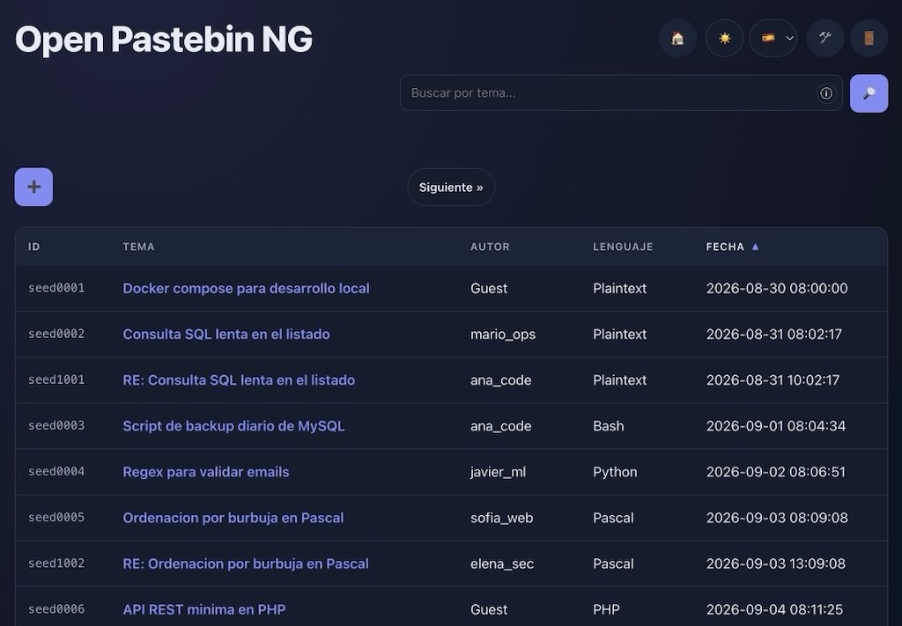
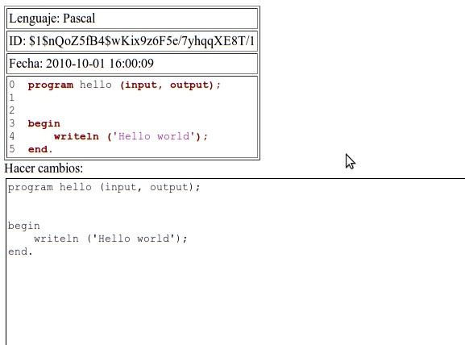
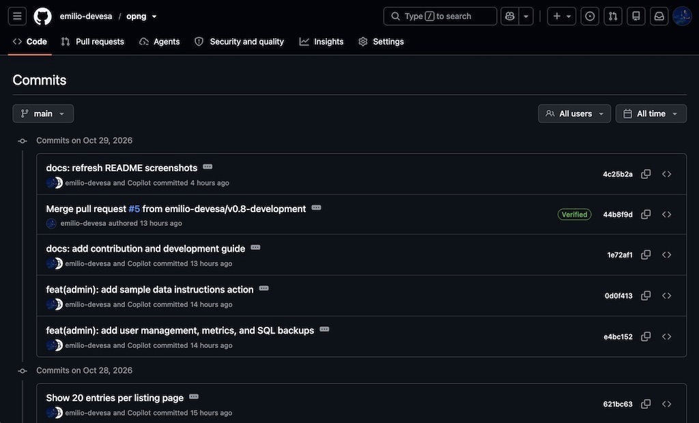
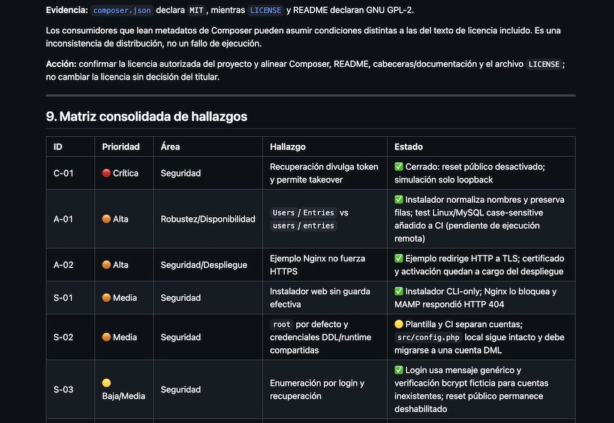

Sometimes, software projects start with a very simple need. You build something to solve a problem, add a few features along the way, and eventually move on to other things. Years later, you might find yourself revisiting that same code, looking at it with a different perspective and wondering how far you can take it.

That's more or less the story behind **Open Pastebin NG (OPNG)**.

## It all started with Pascal

Back in 2010–2011, while studying Computer Science, I wanted a private Pastebin instance that I could run on my own web hosting. The idea was straightforward: have a simple place to share Pascal source code with my classmates without relying on third-party services.

I found [Open Pastebin](https://sourceforge.net/projects/openpastebin/), originally developed by Ville Särkkälä and published on SourceForge in 2004. It was a good starting point, so I forked the project and began adapting it to my needs.

One of my first additions was syntax highlighting for Pascal. I wanted to paste source code and share it with others while keeping it readable and easy to understand.

But the project soon became more than just a place to store snippets.

## A living collection of code snippets

As we started using the application, I added features that made sharing and collaboration more convenient.

A URL shortener made it easier to send links by email. The ability to reply to and modify existing snippets allowed us to correct, improve and adapt each other's code.

The idea wasn't to build a centralized repository for a software project. We already had other ways to manage projects. Instead, OPNG became something closer to a **living Pastebin for code snippets**: a lightweight space where we could exchange ideas, experiment with solutions and build on each other's work.

Over time, I also received comments and suggestions from people who discovered the project through my blog. Josh, also known as Bigbrother, developed his own fork of the project. I later incorporated improvements from his version into mine. Mr. Jarret Stevens also provided suggestions that helped shape the application. These contributions, along with the project's earlier development, are documented in the [changelog](https://github.com/emilio-devesa/opng/blob/main/CHANGELOG.md).

It was an interesting experience: something I had initially built for my own use was becoming a small open source project involving people I didn't personally know.

## When a useful tool becomes a target

Unfortunately, the public-facing application eventually became a target for automated attacks and bot-generated spam.

Maintaining the service started to require more effort than I wanted to invest in it. The project gradually lost momentum, and I eventually stopped developing it.

For several years, OPNG remained one of those projects from an earlier stage of my life: useful, imperfect and largely forgotten.

At the time, I had no particular plan to bring it back. But the code was still there, along with its history.

## Rediscovering OPNG in 2024

In 2024, I decided to publish the project on GitHub as part of my programming portfolio.

Rather than simply uploading the latest version of the source code, I wanted to preserve as much of the original development history as possible, including the sequence of changes and the contributions made by other developers.

That meant revisiting an application written years earlier, understanding how its different parts fitted together, and figuring out what it would take to make it work with a modern version of PHP.

This was also when I began experimenting with the first generations of large language models (LLMs) as programming assistants.

They helped me understand legacy code, investigate compatibility issues and work through changes that would otherwise have taken considerably more time. Revisiting the application also exposed security weaknesses that needed attention before I could feel comfortable continuing its development.

The goal wasn't to rewrite everything from scratch. I wanted to preserve the identity of the original project while making it functional, safer and easier to maintain.

That process gave OPNG a second life.

## From compatibility fixes to a broader modernization

What began as an effort to recover an old PHP application gradually turned into a more ambitious maintenance and modernization project.

Throughout 2025 and 2026, I continued working on the application's security, code quality, robustness, user experience and performance. The work has gone beyond making the software compatible with modern environments: it has also involved revisiting existing implementation choices and improving the foundations on which future features can be built.

One of the most interesting aspects of this process has been developing a more systematic workflow with the help of LLMs.

## A structured workflow with AI-assisted code audits

Rather than asking an AI model to make arbitrary improvements to the codebase, I start each development cycle by creating a branch for the next version.

I then ask an LLM, such as DeepSeek or another coding assistant, to perform a comprehensive analysis of the project and an exhaustive code audit. At this stage, the model must not modify any files. Its job is to identify potential improvements, optimizations, bugs and security issues, paying particular attention to performance, user experience, cybersecurity, robustness and code quality.

The result is a report that includes a prioritized list of findings, categorized by risk level—critical, high, medium or low—and a status for each issue, such as pending, postponed, partially resolved or resolved. The report also proposes a phased action plan. **These audit reports are stored outside the Git repository**, keeping them separate from the project's source code and version-controlled files.

Once the plan is ready, I work through it one phase at a time with the model.

For each phase, the model makes the agreed changes carefully, asking me about uncertainties or decisions that require my input. It then updates the project documentation and the audit report, summarizes what has changed, and points me towards the specific areas I should inspect manually to verify that everything works as expected.

I review the changes before approving a commit. If something isn't right, we go through another round of corrections. If the changes are acceptable, the model creates a commit with a detailed message, and we move on to the next phase.

When all the planned work is complete, I review the remaining issues and decide whether the branch is ready to be pushed. The final step is preparing a pull request to merge the development branch into the main branch. I retain responsibility for reviewing and accepting that pull request.

This workflow doesn't eliminate the need for human judgment or testing. AI-generated changes can introduce regressions, overlook context or suggest solutions that aren't appropriate for the project. The point is to use these tools to accelerate analysis and implementation while keeping the work structured, reviewable and under my control.

For me, one of the biggest advantages is that the audit report becomes a living document: it records what needs attention, what has been addressed and what remains to be done. It also provides a clearer way to approach a codebase that has evolved over many years.

## Keeping the original idea alive

It's relatively easy to keep adding features to an application. It's harder to decide which changes genuinely improve it without making it unnecessarily complicated.

For OPNG, that distinction matters.

I don't want it to become an elaborate platform that requires a complicated setup or extensive maintenance. Its original purpose was to make sharing text and source code as straightforward as possible, and I want that principle to remain central to its development.

There is still work ahead. One of the next goals is to implement a history for each paste, linking it to its ancestors and descendants so that users can follow how snippets evolve over time. I'd also like to offer OPNG as a Docker container to make deploying it in production environments easier and more predictable.

These are future goals rather than features that are already available. Before adding them, I want to keep improving the foundations of the application so that new functionality doesn't come at the expense of security, reliability or simplicity.

The technical details of the changes already implemented, including the improvements introduced in individual releases, are documented in the [project's changelog](https://github.com/emilio-devesa/opng/blob/main/CHANGELOG.md).

## A project with a long history—and more to come

Looking back, OPNG has gone through several distinct stages: a personal tool built for university coursework, a convenient way to exchange code with classmates, a small open source project, an abandoned application, and eventually a project worth revisiting and modernizing.

The technology has changed considerably since I started working on it. So have my own experience and the tools available to me as a developer.

But the underlying idea hasn't changed much.

**Open Pastebin NG is still about sharing code and text quickly, without getting in the way.**

I'm continuing to develop it with that goal in mind: keeping it lightweight, straightforward to use and easier to maintain, while addressing the security and technical challenges that come with running a web application.

If you'd like to explore the current implementation, check out the source code, follow its development or contribute, you'll find everything on [GitHub](https://github.com/emilio-devesa/opng/).

And if you've used OPNG, have ideas for improving it, or simply enjoy seeing old software projects evolve, I'd be happy to hear from you.

Thanks for reading!